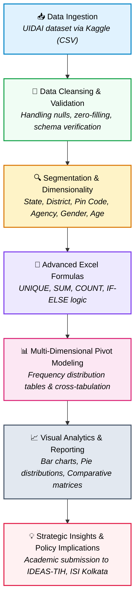
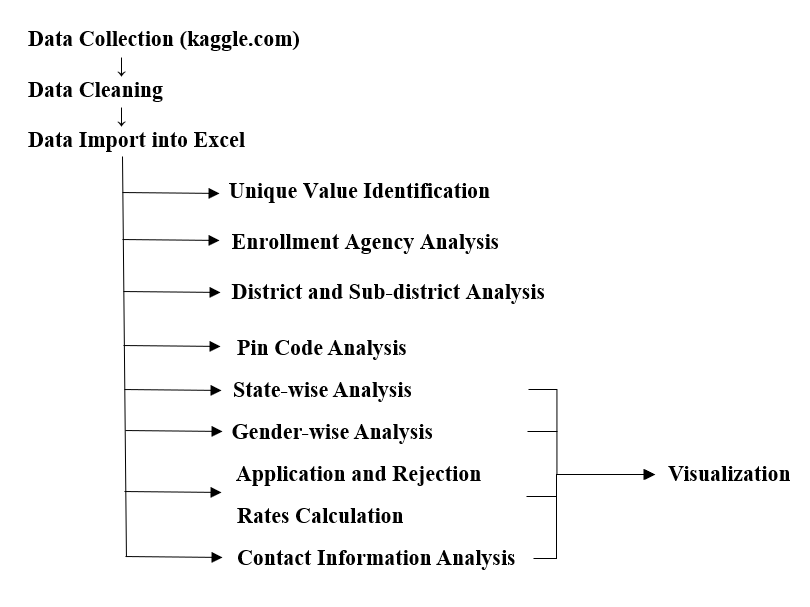
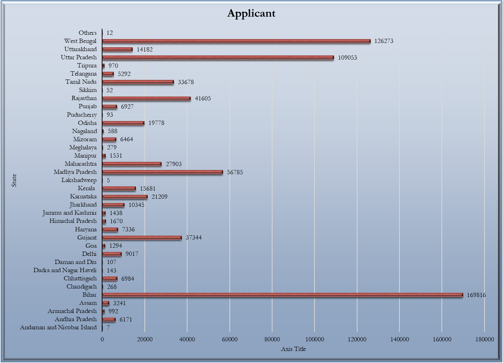
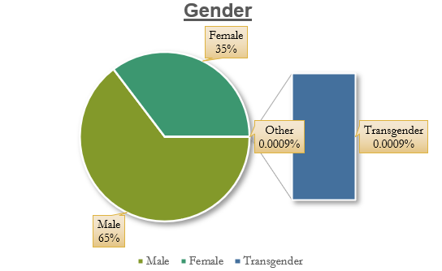
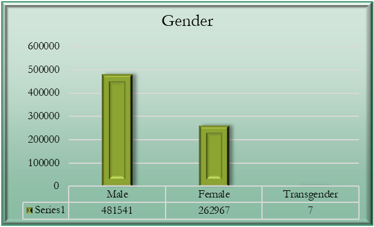
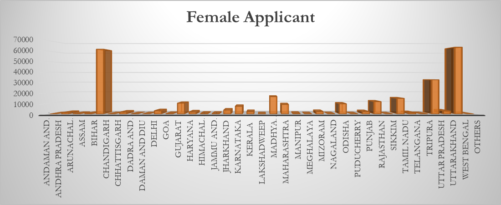
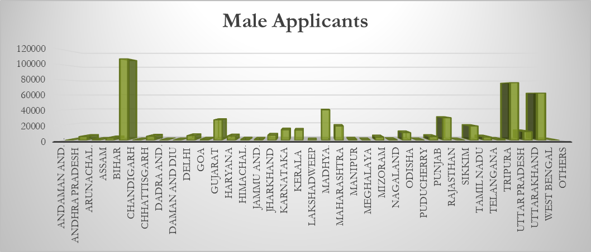
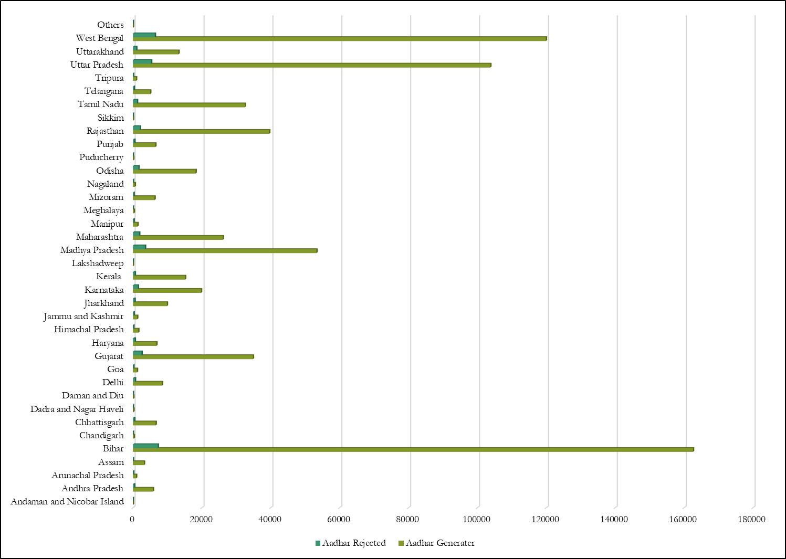
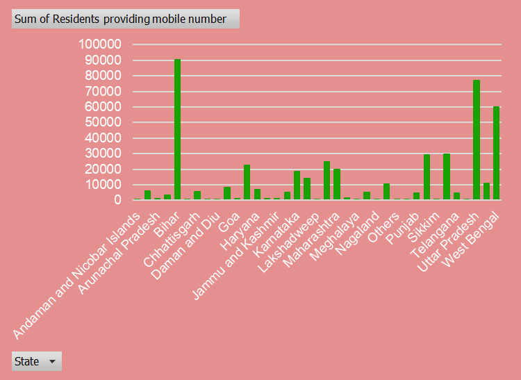
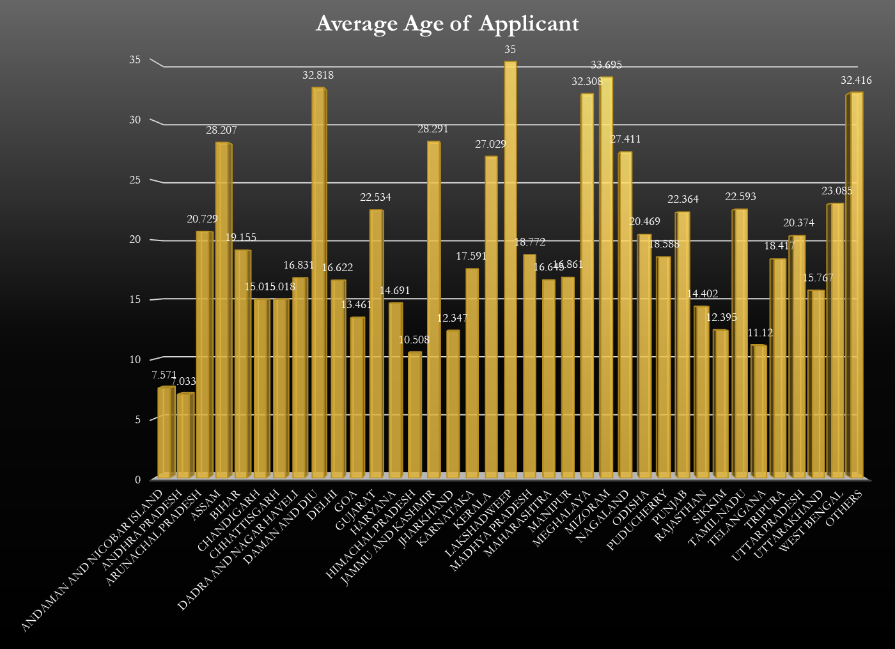

# 🇮🇳 Aadhaar Enrollment & Demographic Data Analysis — All India

<div align="center">


-800000?style=for-the-badge)


<br/>

**A data-driven analytical study examining nationwide Aadhaar card generation, gender disparities, application rejection dynamics, and digital contact adoption across 37 Indian States and Union Territories.**

*Conducted at the **Institute of Data Engineering, Analytics and Science Foundation (IDEAS-TIH), Indian Statistical Institute (ISI), Kolkata.***

[Executive Summary](#-executive-summary) • [Key Statistics](#-statistical-snapshot) • [Methodology](#-methodology--analytical-workflow) • [Visual Findings](#-in-depth-findings--visualizations) • [Policy Recommendations](#-strategic-recommendations--policy-implications) • [Report](#-full-research-report)

</div>

---

## 📌 Executive Summary

The **Aadhaar** project by the Unique Identification Authority of India (UIDAI) is the world's largest biometric identity program, serving as the foundational infrastructure for citizen authentication, direct benefit transfers (DBT), financial inclusion, and public service delivery across India.

This project delivers a comprehensive analytical study of daily Aadhaar enrollment records sourced from Kaggle. By analyzing **744,533 applicant records across 37 States and Union Territories**, this research evaluates:
- Geographic and regional volume variations in enrollment.
- Gender distribution across regions and underlying disparities.
- Application success vs. rejection rates and failure dynamics.
- Digital engagement metrics through mobile number and email ID linkage.
- Age profiles across diverse state populations.

The findings offer practical empirical insights to help policymakers, district administrators, and UIDAI stakeholders optimize enrollment operations, eliminate gender gaps, and bolster digital citizen engagement.

---

## 📊 Statistical Snapshot

<div align="center">

| Metric | Count | Percentage / Notes |
|:---|:---:|:---|
| **Total Applicants Analyzed** | **744,533** | Across 37 States & Union Territories |
| **Aadhaar Successfully Generated** | **705,939** | **94.82%** Acceptance Rate |
| **Aadhaar Applications Rejected** | **38,576** | **5.18%** Rejection Rate |
| **Male Applicants** | **481,541** | **64.68%** of total applicants |
| **Female Applicants** | **262,967** | **35.32%** of total applicants |
| **Transgender Applicants** | **7** | **~0.001%** representation |
| **Top State for Female Enrollment** | **West Bengal** | **63,714** female applicants |
| **Top State for Male Enrollment** | **Bihar** | **108,030** male applicants |
| **Youth Digital Linkage** | **~100%** | Near-universal mobile & email sharing among youth |

</div>

---

## 🎯 Research Objectives

1. **State-wise Geographic Distribution**: Map enrollment volume across 37 States & UTs to uncover regional concentration and under-represented areas.
2. **Gender Parity & Demographic Gaps**: Contrast Male vs. Female vs. Transgender application rates and pinpoint states with stark gender skews.
3. **Application Outcome Evaluation**: Measure acceptance and rejection distributions to assess documentation and registration friction.
4. **Digital Identity Enablement**: Assess the proportion of applicants providing verified contact information (Mobile & Email) for e-KYC readiness.
5. **Age-Centric Demographics**: Profile the average age of applicants across states to understand migration and age-specific registration requirements.
6. **Actionable Policy Roadmap**: Propose targeted interventions for UIDAI enrollment agencies and state governments.

---

## 🔬 Methodology & Analytical Workflow

The project employed an end-to-end data analytics lifecycle executed on **Microsoft Excel 2021 (Advanced Data Analytics)**:



<div align="center">
  
  <p><i>Figure 1: High-level analytics and data processing workflow.</i></p>
</div>

### Key Analytical Techniques Used:
- **`UNIQUE`**: Extracted distinct entries across states, districts, pin codes, and enrollment agencies to assess geographic breadth.
- **`SUM` & `COUNT`**: Computed total generation vs. rejection volumes and state-wise tallies.
- **`IF-ELSE`**: Created conditional flags for acceptance thresholds, phone linkage classifications, and demographic categories.
- **Pivot Tables**: Built multi-level drill-downs correlating enrollment agency performance with rejection rates.
- **Frequency Distribution Tables**: Analyzed demographic spread and age group distributions.

---

## 📈 In-Depth Findings & Visualizations

### 1. State-wise Total Enrollment Distribution
Across the **744,533 total applicants**, enrollment density reveals high variation based on state population, digital awareness, and localized registration campaigns. High-population states (such as Bihar, Uttar Pradesh, and West Bengal) dominate total volume, while North-Eastern and Union Territory jurisdictions exhibit compact volumes.

<div align="center">
  
  <p><i>Figure 2: Distribution of total Aadhaar enrollment applications across 37 States and UTs.</i></p>
</div>

---

### 2. Gender Demographic Disparity

A national breakdown of the enrollment data reveals a pronounced gender gap:
- **Male**: 481,541 applicants (**64.68%**)
- **Female**: 262,967 applicants (**35.32%**)
- **Transgender**: 7 applicants (**~0.001%**)

The male-to-female application ratio stands at nearly **1.83 : 1**, highlighting the pressing need for dedicated female-centric registration camps and community mobilization.

<div align="center">
  <table>
    <tr>
      <td align="center"><b>Gender Distribution (Bar Chart)</b></td>
      <td align="center"><b>Gender Proportion (Pie Chart)</b></td>
    </tr>
    <tr>
      <td></td>
      <td></td>
    </tr>
  </table>
  <p><i>Figure 3: Gender breakdown of enrollment applicants across India.</i></p>
</div>

---

### 3. State-wise Gender Dynamics: Regional Leaders

Analyzing gender distribution regionally reveals intriguing state-level divergences:
- **West Bengal** achieved the highest number of **female applicants** nationwide (**63,714**), demonstrating strong institutional and community-level participation of women.
- **Bihar** recorded the highest volume of **male applicants** (**108,030**), reflecting substantial migrant and workforce registration demands.

<div align="center">
  <table>
    <tr>
      <td align="center"><b>State-wise Female Applicants (Top: West Bengal)</b></td>
    </tr>
    <tr>
      <td></td>
    </tr>
    <tr>
      <td align="center"><b>State-wise Male Applicants (Top: Bihar)</b></td>
    </tr>
    <tr>
      <td></td>
    </tr>
  </table>
  <p><i>Figure 4: Comparative regional distribution of Female vs. Male applicants.</i></p>
</div>

---

### 4. Application Success vs. Rejection Dynamics

Out of 744,533 applications processed:
- **705,939 Aadhaar numbers were successfully generated** (94.82% success rate).
- **38,576 applications were rejected** (5.18% rejection rate).

While the overall conversion rate is robust, certain states show disproportionate rejection volumes. Primary drivers for rejection identified in literature and agency data include:
1. Inadequate or non-standard proof of address (PoA) / proof of identity (PoI).
2. Biometric capture errors (particularly among elderly manual laborers and young children).
3. Demographic mismatches in names, dates of birth, or parental records.

<div align="center">
  
  <p><i>Figure 5: Total Aadhaar numbers generated versus applications rejected by state.</i></p>
</div>

---

### 5. Digital Engagement: Mobile Number Linkage

Linking a mobile number is vital for multi-factor authentication (OTP-based Aadhaar services, DigiLocker, UPI, and Direct Benefit Transfers).

Key findings:
- Higher literacy and urbanized states demonstrate significantly higher rates of residents providing contact numbers.
- **Age correlation**: Younger applicants (under 30 years) provided mobile numbers and email addresses at a rate approaching **nearly 100%**.
- Older rural cohorts showed lower voluntary phone registration, highlighting a digital accessibility gap.

<div align="center">
  
  <p><i>Figure 6: Sum of residents providing mobile phone numbers across states.</i></p>
</div>

---

### 6. State-wise Average Age Profile

The average age of applicants varies across states, serving as an indicator of:
- High birth-rate regions where child/minor registrations are prevalent.
- In-migration / out-migration corridors where working-age adults update or initiate enrollment.

<div align="center">
  
  <p><i>Figure 7: Mean applicant age distributed across Indian states.</i></p>
</div>

---

## 💡 Strategic Recommendations & Policy Implications

Based on the quantitative insights, the following policy interventions are recommended:

1. **Targeted Female Mobilization Campaigns**:
   - Establish dedicated women-only mobile enrollment units and leverage self-help groups (SHGs) and Anganwadi networks, especially in states lagging in female participation.
2. **Rejection Mitigation & Document Assistance**:
   - Implement pre-submission document validation check-lists at the registrar level to curb the **38,576+ rejections**.
   - Provide biometric exception mechanisms for elderly citizens and agricultural workers with worn fingerprints.
3. **Closing the Digital Contact Gap**:
   - Incentivize mobile linkage during enrollment by showcasing benefits (e-Aadhaar downloads, SMS alerts for DBT credit, DigiLocker access).
   - Conduct phone update drives in rural banking correspondence centers.
4. **Agency Performance Benchmarking**:
   - Audit enrollment agencies with above-average rejection rates to identify whether hardware degradation or inadequate operator training is responsible.

---

## 📁 Repository Structure

```text
Aadhaar-Data-Analysis-India/
├── assets/                                      # Extracted visual charts & diagrams
│   ├── gender_distribution_bar.png             # Gender breakdown (Bar diagram)
│   ├── gender_distribution_pie.png             # Gender proportion (Pie chart)
│   ├── methodology_flowchart.png               # Project workflow & pipeline diagram
│   ├── statewise_average_age.png               # State-wise average applicant age chart
│   ├── statewise_female_applicants.png         # Female applicants per state
│   ├── statewise_generated_vs_rejected.png     # Acceptance vs. rejection comparison
│   ├── statewise_male_applicants.png           # Male applicants per state
│   ├── statewise_mobile_linkage.png            # Contact linkage rates across states
│   └── statewise_total_applicants.png          # Overall applicant distribution
│
├── Daily Aadhar Generated By Gender & Age.pdf  # Full 16-page official academic project report
└── README.md                                   # Comprehensive research documentation
```

---

## 📄 Full Research Report

The complete 16-page formal report submitted to **IDEAS-TIH, Indian Statistical Institute (ISI), Kolkata** is available in this repository:
📄 **[`Daily Aadhar Generated By Gender & Age.pdf`](Daily%20Aadhar%20Generated%20By%20Gender%20&%20Age.pdf)**

### Report Table of Contents:
- **Title Page & Academic Affiliation** (Page 1)
- **Abstract & Relevance** (Page 2)
- **Introduction & Background Survey** (Page 3)
- **Project Objectives** (Page 4)
- **Methodology & Data Cleansing** (Page 5)
- **Tools, Formulas & Visualization Techniques** (Page 6)
- **Detailed Step-by-Step Analysis** (Page 7)
- **Activity Flow Chart** (Page 8)
- **State-wise Application Results** (Page 9)
- **Gender-wise Application Results** (Page 10)
- **State-wise Average Age of Applicants** (Page 11)
- **Regional Gender Bifurcation: WB vs. Bihar** (Page 12)
- **State-wise Mobile Number Registration** (Page 13)
- **State-wise Rejection vs. Generation Statistics** (Page 14)
- **Conclusion & Future Scope** (Page 15)
- **Appendices, Datasets & References** (Page 16)

---

## 👥 Authors & Academic Credits

- **Principal Researcher**: **Debabrata Mondal**
  - *Summer Research Intern (Batch 2023, Team 19)*
  - *Affiliation: Asutosh College, University of Calcutta*
- **Project Mentor**: **Prasun Dutta**
- **Hosting Institute**: **Institute of Data Engineering, Analytics and Science Foundation (IDEAS-TIH)**,  
  **Indian Statistical Institute (ISI), Kolkata**, West Bengal, India.

---

## 📚 Data Source & Acknowledgments

- **Dataset**: UIDAI Aadhaar Card Data Analysis Dataset ([Available on Kaggle](https://www.kaggle.com/code/jindala/aadhar-card-data-analysis)).
- Special gratitude to **IDEAS-TIH, ISI Kolkata** for research infrastructure, mentorship, and domain guidance.

---

<div align="center">
  <sub>Released under the MIT License • Built with ❤️ for open public policy research in India.</sub>
</div>
